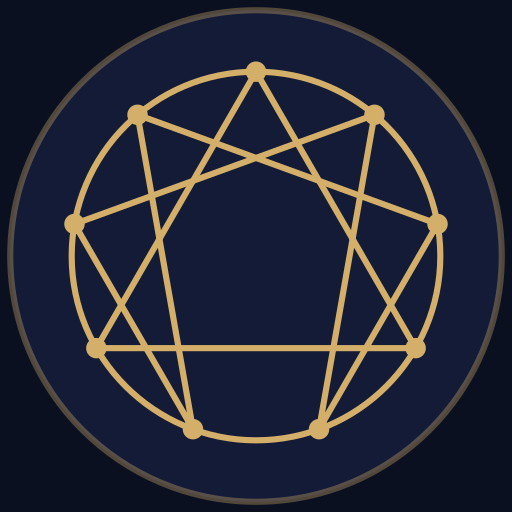
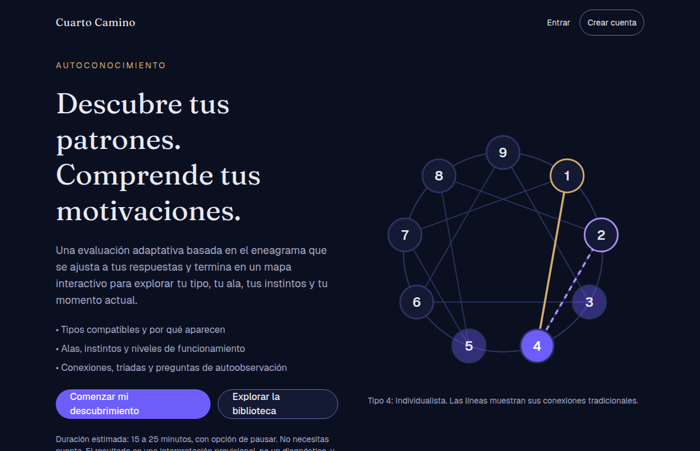
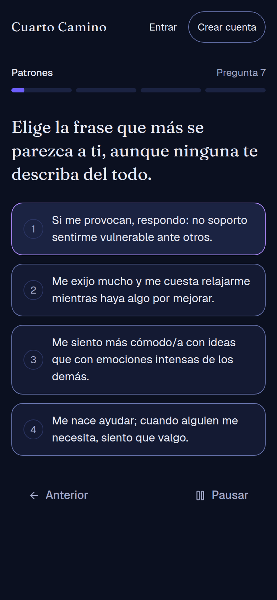
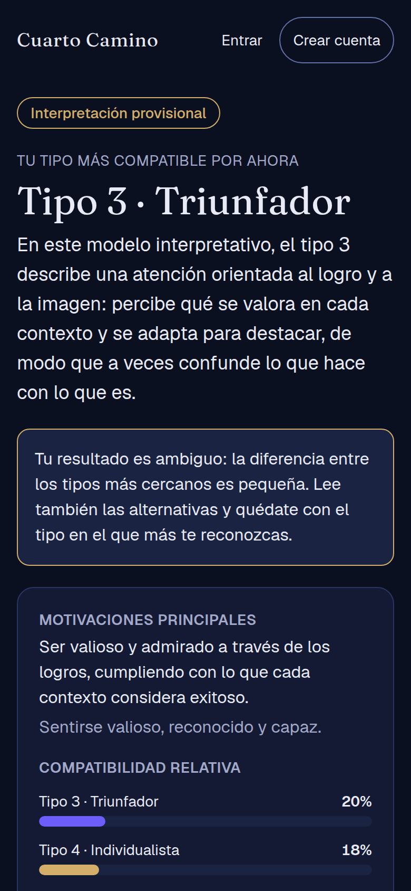
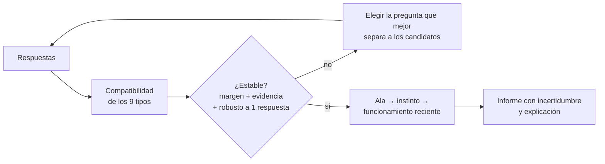
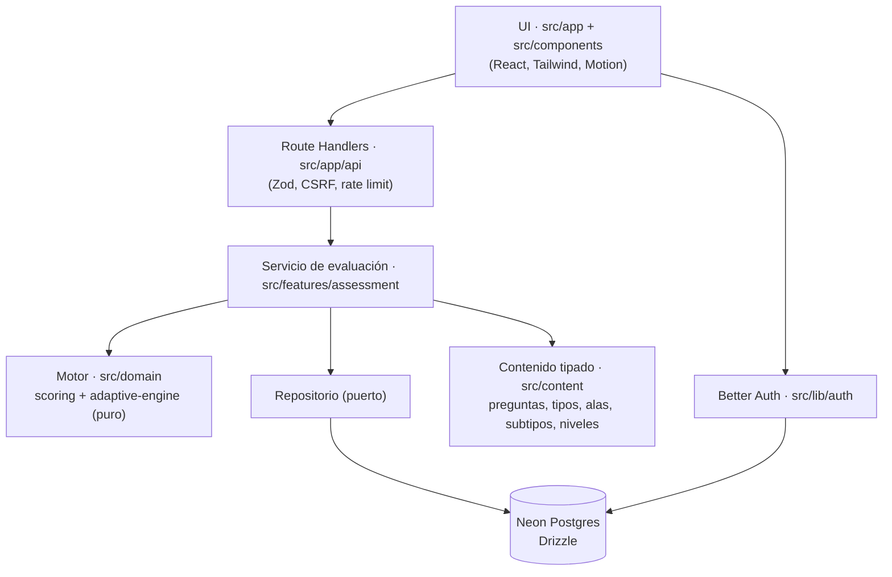

<div align="center">



# Cuarto Camino

**Descubre tus patrones. Comprende tus motivaciones. Aprende a observarte. Construye tu propio camino.**

Una evaluación adaptativa del eneagrama que termina en un mapa interactivo y transparente de tu personalidad,
presentado como lo que es: una **interpretación provisional**, no un diagnóstico.

[](https://github.com/julianramirezreyes/cuarto-camino/actions/workflows/ci.yml)


</div>

<br />

<div align="center">
  
  &nbsp;
  
  &nbsp;
  
</div>

<br />

> [!IMPORTANT]
> **Estado: MVP técnico funcional, todavía no validado.** El banco de preguntas, sus puntajes y todas las fichas editoriales
> (tipos, alas, subtipos y niveles) son **borradores pendientes de revisión por especialistas**, y el cuestionario no ha pasado
> por un estudio piloto. Hoy el resultado es una pista para explorar, no una medición confiable. Lee
> [`docs/validacion-psicometrica.md`](docs/validacion-psicometrica.md) antes de compartirlo como instrumento.

## Contenido

- [¿Qué hace?](#qué-hace)
- [Cómo decide: el motor adaptativo](#cómo-decide-el-motor-adaptativo)
- [Arquitectura](#arquitectura)
- [Empezar](#empezar)
- [Variables de entorno](#variables-de-entorno)
- [Scripts](#scripts)
- [Pruebas](#pruebas)
- [Seguridad y privacidad](#seguridad-y-privacidad)
- [Despliegue](#despliegue)
- [Documentación](#documentación)
- [Limitaciones conocidas y hoja de ruta](#limitaciones-conocidas-y-hoja-de-ruta)

## ¿Qué hace?

1. **Evaluación adaptativa.** No todas las personas reciben las mismas preguntas: el motor elige la siguiente según las respuestas
   anteriores, hasta que el resultado es estable o llega al máximo. Una pregunta por pantalla, con pausa, retroceso y guardado
   automático.
2. **Mapa personal interactivo (12 secciones).** Tipo probable y alternativas, ala, instintos, nivel de funcionamiento reciente,
   patrones automáticos, fortalezas, dificultades, conexiones (flechas, centros y grupos), dirección de crecimiento, cómo se
   obtuvo el resultado y bibliografía. Se puede explorar **cualquiera de los nueve tipos**.
3. **Biblioteca pública.** Historia del símbolo y de cada escuela (Gurdjieff, Ichazo, Naranjo, Riso-Hudson, Chestnut, Palmer), los
   nueve tipos, las 18 alas, los **27 subtipos** instintivos y los **81 niveles** (9 por tipo).
4. **Sin cuenta obligatoria.** Sesión de invitado con cookie segura; opcionalmente crear cuenta y **vincular** el resultado.
5. **Honestidad por diseño.** Los porcentajes son «compatibilidad relativa», nunca precisión; si hay ambigüedad o poca evidencia lo
   dice; nunca infiere salud mental ni asigna una pila instintiva completa.
6. **PWA instalable**, modo oscuro y claro, `prefers-reduced-motion`, y accesibilidad WCAG 2.2 AA verificada con axe.

## Cómo decide: el motor adaptativo

El motor es TypeScript puro y determinista, **independiente de React** (reutilizable desde otro cliente). Documentación completa en
[`docs/motor-evaluacion.md`](docs/motor-evaluacion.md).



- Módulos: tipo → ala → instinto → funcionamiento (últimas 4 semanas), cada uno con mínimo y máximo configurables.
- No se detiene por una sola respuesta decisiva, evita formulaciones equivalentes y detecta inconsistencias.
- Cada resultado guarda la versión del motor y del banco: **cambiar el algoritmo no reescribe el pasado**.
- Las puntuaciones son compatibilidad relativa **sin calibrar**; las pruebas sintéticas verifican el cableado, no la validez.

## Arquitectura

Monolito modular en Next.js (App Router). La lógica de dominio no depende de la interfaz.



```text
src/
├── app/            Rutas, páginas y Route Handlers (api/, cuenta/, biblioteca/, resultado/ …)
├── components/     assessment/ results/ enneagram/ library/ account/ pwa/ ui/ layout/
├── domain/         enneagram/ scoring/ adaptive-engine/ assessment/   (sin React)
├── features/       assessment/   servicio, repositorios, DTOs, límite de tasa
├── content/        schema + preguntas + tipos, alas, subtipos y niveles (borrador)
├── lib/            db/ (Drizzle) auth/ email/ guest/ validation/
└── hooks/          estado del cuestionario
drizzle/            migraciones versionadas      docs/        documentación
e2e/                pruebas Playwright           scripts/     semilla y purga
```

| Capa | Tecnología |
| --- | --- |
| Framework | Next.js 16 (App Router, Cache Components), React 19, TypeScript estricto |
| Estilos y animación | Tailwind CSS 4, Motion, Lucide |
| Datos | Neon PostgreSQL, Drizzle ORM + Drizzle Kit (migraciones versionadas) |
| Autenticación | Better Auth (correo y contraseña) sobre la misma base |
| Validación | Zod 4 en toda entrada del servidor |
| Calidad | Vitest, React Testing Library, Playwright + axe, ESLint, GitHub Actions |
| Despliegue | Vercel (con cron de purga) |

> **¿Por qué Better Auth y no Neon Auth?** Neon Auth es Better Auth gestionado, pero su remitente de correo compartido es solo para
> pruebas y producción exige tu propio SMTP de todas formas; además habría obligado a rehacer cuentas y vinculación de invitados.
> Detalle en [`docs/base-de-datos.md`](docs/base-de-datos.md).

## Empezar

Requisitos: **Node 24**, **npm** y una base de datos en [Neon](https://neon.com).

```bash
git clone https://github.com/julianramirezreyes/cuarto-camino.git
cd cuarto-camino
npm install
```

Crea `.env.local` (ver la tabla siguiente), prepara la base y arranca:

```bash
npm run db:migrate   # aplica las migraciones de drizzle/
npm run db:seed      # carga tipos, alas, conexiones, subtipos y niveles (idempotente)
npm run dev          # http://localhost:3000
```

## Variables de entorno

Nunca se suben al repositorio (`.env*` está ignorado). Ninguna llega al navegador.

| Variable | Obligatoria | Descripción |
| --- | :---: | --- |
| `DATABASE_URL` | Sí | Cadena **pooled** de Neon (`?sslmode=require`). |
| `AUTH_SECRET` | Sí | Secreto de ≥ 32 caracteres: `openssl rand -base64 32`. |
| `BETTER_AUTH_URL` | Sí | Origen público de la app (`http://localhost:3000` en local). |
| `APP_URL` | Sí | Igual que `BETTER_AUTH_URL`. |
| `CRON_SECRET` | En producción | Protege `/api/cron/purge`. Sin ella la purga no corre. |
| `RATE_LIMIT_SALT` | No | Sal del hash de IP del límite de tasa (por defecto se deriva de `AUTH_SECRET`). |
| `SMTP_HOST` `SMTP_PORT` `SMTP_USER` `SMTP_PASS` `EMAIL_FROM` | No | Activan verificación de correo y recuperación de contraseña. Ver [`docs/correo.md`](docs/correo.md). |

> Sin SMTP la app funciona igual, pero **sin** verificación de correo ni recuperación de contraseña.

## Scripts

| Comando | Qué hace |
| --- | --- |
| `npm run dev` / `build` / `start` | Desarrollo, compilación y servidor de producción |
| `npm run lint` · `typecheck` | ESLint · TypeScript |
| `npm test` · `test:watch` | Pruebas unitarias y de componentes (Vitest) |
| `npm run test:e2e` | Pruebas de extremo a extremo (Playwright, escritorio y móvil) |
| `npm run db:generate` · `db:migrate` | Generar y aplicar migraciones |
| `npm run db:seed` · `db:purge` | Cargar datos de referencia · purgar datos vencidos |

## Pruebas

- **Más de mil pruebas unitarias y de componentes** (dominio, motor, contenido, API, formularios, tema) con Vitest.
- **Playwright** sobre la compilación de producción, en escritorio y móvil (Pixel 7): recorrido completo hasta el resultado,
  retroceso y pausa, **cuentas (registro, vinculación del resultado, salir/entrar y eliminar)**, privacidad entre visitantes,
  responsive en seis anchos, PWA y **accesibilidad con axe** (sin violaciones
  WCAG A/AA). Guía en [`docs/pruebas-e2e.md`](docs/pruebas-e2e.md).
- **Desarrollo guiado por pruebas:** primero la prueba que falla, luego el código.
- Las pruebas sintéticas del motor **no** son validación psicométrica.

## Seguridad y privacidad

- Validación Zod estricta en el servidor, control de acceso por propietario (los ajenos reciben `404`, no `403`) y defensa CSRF por
  `Origin`.
- Cookies `httpOnly`, `SameSite=Lax` y `Secure`; el invitado se identifica con un token aleatorio de 32 bytes del que **solo se guarda
  el hash**.
- Cabeceras: CSP, HSTS, `X-Content-Type-Options`, `Referrer-Policy`, `Permissions-Policy`, COOP y `X-Frame-Options`.
- Límite de tasa compartido en Postgres (la IP se guarda hasheada) y purga diaria con retención definida.
- Los puntajes, pesos y justificaciones de las preguntas **nunca** llegan al cliente.
- La caché del service worker excluye `/api`, `/evaluacion` y `/resultado`; nada privado se guarda en cachés compartidas.
- Cuenta y datos eliminables desde `/cuenta`. Los registros no incluyen respuestas ni correos.

Más detalle y límites honestos en [`docs/seguridad-y-pwa.md`](docs/seguridad-y-pwa.md) y [`docs/retencion-y-limites.md`](docs/retencion-y-limites.md).

## Despliegue

Pensado para Vercel + Neon. Guía paso a paso, lista de variables y verificación posterior en
[`docs/despliegue.md`](docs/despliegue.md).

## Documentación

| Documento | Contenido |
| --- | --- |
| [`motor-evaluacion.md`](docs/motor-evaluacion.md) | Algoritmo, fórmulas, parámetros y límites del motor |
| [`validacion-psicometrica.md`](docs/validacion-psicometrica.md) | Plan para validar el cuestionario |
| [`api.md`](docs/api.md) | Contrato HTTP, errores y seguridad de la API |
| [`base-de-datos.md`](docs/base-de-datos.md) | Esquema, decisiones y retención |
| [`cuentas.md`](docs/cuentas.md) · [`correo.md`](docs/correo.md) | Cuentas, vinculación de invitados y correo |
| [`seguridad-y-pwa.md`](docs/seguridad-y-pwa.md) | Cabeceras, caché, instalabilidad y lista de lanzamiento |
| [`retencion-y-limites.md`](docs/retencion-y-limites.md) | Retención de datos y límite de tasa |
| [`pruebas-e2e.md`](docs/pruebas-e2e.md) | Cómo correr y ampliar Playwright |
| [`lighthouse.md`](docs/lighthouse.md) | Mediciones de rendimiento, accesibilidad, buenas prácticas y SEO en producción |
| [`despliegue.md`](docs/despliegue.md) | Publicar en Vercel |

## Limitaciones conocidas y hoja de ruta

**Antes de un lanzamiento público**

- Revisión editorial por especialistas de todo el contenido y verificación de fuentes (contratipos de 1, 3 y 9 sin resolver).
- Estudio piloto y calibración del cuestionario ([plan](docs/validacion-psicometrica.md)); el módulo de ala tiene solo 3 preguntas por
  tipo (objetivo: 4 a 6).
- Política de privacidad y datos del responsable del tratamiento (Ley 1581 de 2012), hoy marcados como pendientes.
- Dominio propio y proveedor de correo para activar verificación y recuperación de contraseña.
- Pendientes menores: descarga del resumen en PDF, «revisar mis respuestas», analítica anónima de producto, CSP con nonces en lugar de
  `'unsafe-inline'`, pruebas en dispositivos reales y navegadores distintos de Chrome (Lighthouse ya medido: ver `docs/lighthouse.md`).

**Visión futura (no incluida)**: caminos de crecimiento inspirados en el Cuarto Camino, ejercicios de autoobservación y recuerdo de sí,
diarios, seguimiento longitudinal y comunidades. La arquitectura está preparada para incorporarlos, pero **no hay módulos vacíos**
que simulen que ya existen.

## Aviso editorial

El eneagrama es un modelo interpretativo con evidencia científica limitada. Los nueve tipos modernos **no** provienen de Gurdjieff
(el símbolo sí, vía Ouspensky). Este proyecto no hace diagnósticos ni infiere salud mental, y ningún resultado debe tomarse como una
etiqueta definitiva sobre una persona.

**Licencia:** por definir.
